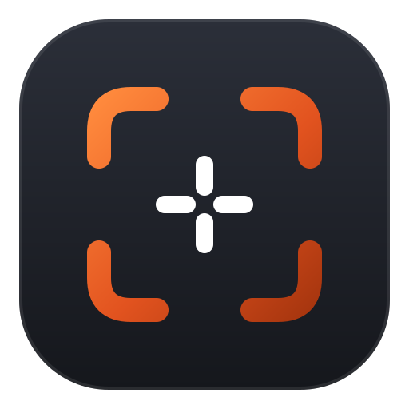
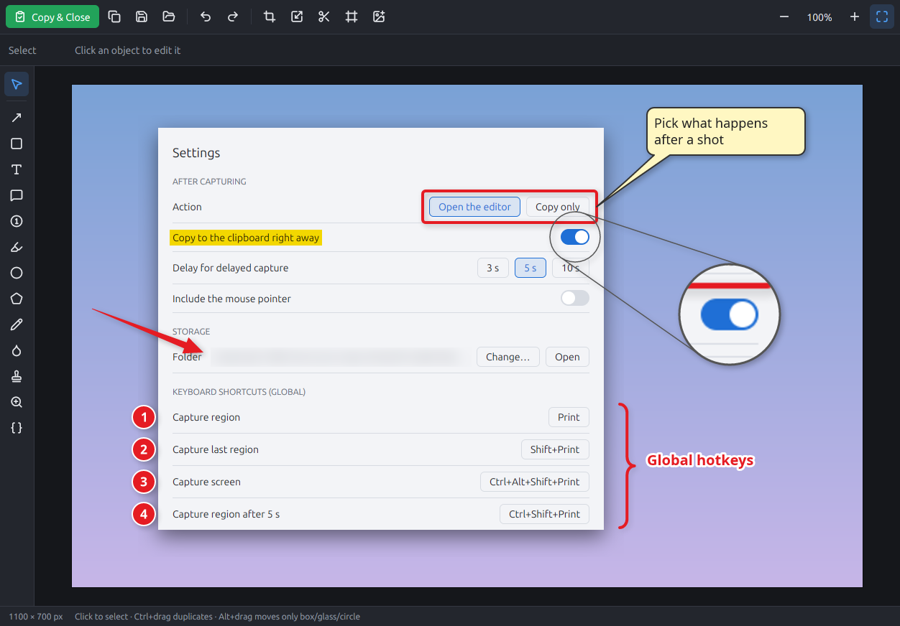
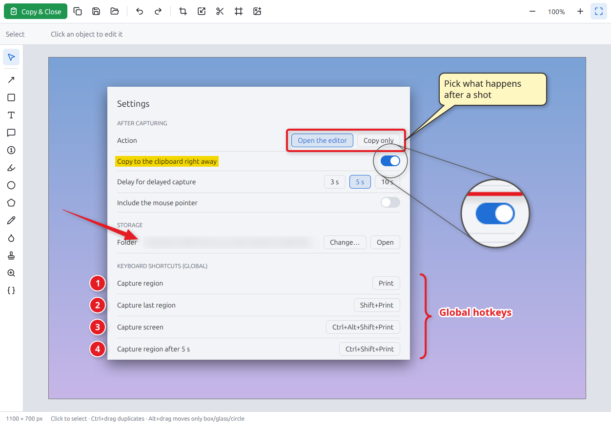
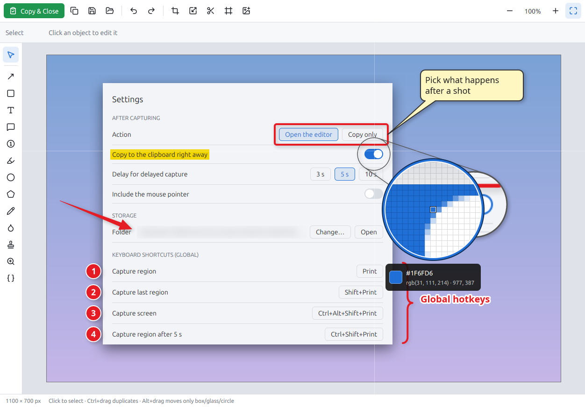

<div align="center">



# OxShot

**Fast screenshots for Linux, in the spirit of [Screenpresso](https://www.screenpresso.com/) by Learnpulse.**

**Press <kbd>Print</kbd>, pick a region, mark it up, <kbd>Ctrl</kbd>+<kbd>C</kbd>. Done.**

*Capture. Annotate. Paste.*

### Install on Debian, Ubuntu or Linux Mint

```sh
wget https://github.com/srcmkr/OxShot/releases/latest/download/oxshot_amd64.deb
sudo apt install ./oxshot_amd64.deb
```

Other distributions: download the
**[AppImage](https://github.com/srcmkr/OxShot/releases/latest/download/OxShot-x86_64.AppImage)**,
make it executable and start it.

[](https://github.com/srcmkr/OxShot/releases/latest)
[](https://github.com/srcmkr/OxShot/actions/workflows/build.yml)
[](#license)



</div>

## What it does

- **On screen before you notice**: the capture overlay is created once and only
  shown per capture, so it appears within a few dozen milliseconds of pressing
  <kbd>Print</kbd>. The screen freezes; hovering highlights the window under
  the pointer (click to take it), dragging selects any region, and a pixel
  magnifier and the arrow keys make it exact.
- **Straight into the editor**: the capture is saved and on the clipboard at
  once; the editor opens, you annotate, <kbd>Ctrl</kbd>+<kbd>C</kbd> copies
  the result.
- **Thirteen annotation tools**: arrows (straight, curved, tapered), rectangles,
  ellipses, text with outline, speech bubbles with a movable tail, numbered
  steps that count up by themselves (with an optional connector), highlighter,
  blur and pixelate, magnifier, curly brace, polygon, freehand and images.
- **Annotations stay editable**: every capture keeps a project file next to
  it, so arrows and texts can still be moved or changed days later.
- **Image operations**: non-destructive crop, resize, cutting a strip out of
  the middle (straight, zigzag or wavy edge), and borders and effects: shadow,
  rounded corners, torn edges, reflection, grayscale, rotation.
- **Color picker**: <kbd>Ctrl</kbd>+<kbd>Print</kbd> freezes the screen with a
  round magnifier; a click copies `#RRGGBB`. The editor's color menu picks
  from the screen too and remembers recent colors.
- **Delayed capture**: <kbd>Ctrl</kbd>+<kbd>Shift</kbd>+<kbd>Print</kbd>
  counts down 3, 5 or 10 seconds without taking the focus, so open menus and
  tooltips end up in the picture.
- **Pastes the way the target wants it**: the clipboard offers the image as
  PNG (chat, mail, image editors), the saved file (file managers, uploads) and
  its path (terminals) at the same time.
- **History**: all captures in one grid. Search, copy, rename (a new extension
  converts the format), move to the trash, drop images in to import them.

<table>
  <tr>
    <td></td>
    <td></td>
  </tr>
</table>

## Install

Every [release](https://github.com/srcmkr/OxShot/releases/latest) has three files:

| For | File | Then |
|---|---|---|
| Debian, Ubuntu, Linux Mint | `oxshot_<version>_amd64.deb` | `sudo apt install ./oxshot_*_amd64.deb` |
| Any other distribution | `OxShot-<version>-x86_64.AppImage` | `chmod +x OxShot-*.AppImage && ./OxShot-*.AppImage` |
| By hand | `oxshot-<version>-x86_64-linux.tar.gz` | Unpack, start `./oxshot`, then *Settings → Updates → Install for all users* |

OxShot runs in the background with a tray icon. You need a tray that supports
StatusNotifierItem (Cinnamon, KDE, XFCE, GNOME with the AppIndicator
extension). *Settings → System* can start it at login and add a menu entry.

New versions are offered in the tray and the settings and installed on
request; every file of a release is signed, and only a correctly signed one is
installed.

If your desktop already uses <kbd>Print</kbd> for its own screenshot tool,
remove that shortcut (Cinnamon: *System Settings → Keyboard → Shortcuts*) or
bind `oxshot capture` there instead.

OxShot is developed on X11 (Cinnamon); Wayland is not supported yet.

## Using it

| Keys (global) | Does |
|---|---|
| <kbd>Print</kbd> | capture a region, a window or a monitor |
| <kbd>Shift</kbd>+<kbd>Print</kbd> | capture the same region as last time |
| <kbd>Ctrl</kbd>+<kbd>Alt</kbd>+<kbd>Shift</kbd>+<kbd>Print</kbd> | capture the monitor under the pointer |
| <kbd>Ctrl</kbd>+<kbd>Shift</kbd>+<kbd>Print</kbd> | capture a region after a countdown |
| <kbd>Ctrl</kbd>+<kbd>Print</kbd> | pick a color from the screen |

All of them can be changed under *Settings → Keyboard shortcuts*.

**While capturing**: click takes the highlighted window, dragging selects a
region, the top edge of a monitor takes the whole monitor. Arrow keys move by
one pixel (<kbd>Shift</kbd>: ten), <kbd>Space</kbd> starts and ends a
selection, <kbd>F</kbd> takes the monitor, <kbd>A</kbd> all monitors,
<kbd>M</kbd> includes the mouse pointer, the mouse wheel zooms the magnifier,
<kbd>H</kbd> shows help, <kbd>Esc</kbd> or a right-click cancels.

**In the editor**:

| Keys | Does |
|---|---|
| <kbd>V</kbd> <kbd>A</kbd> <kbd>R</kbd> <kbd>T</kbd> <kbd>B</kbd> <kbd>N</kbd> <kbd>H</kbd> <kbd>E</kbd> <kbd>P</kbd> <kbd>F</kbd> <kbd>X</kbd> <kbd>I</kbd> <kbd>M</kbd> <kbd>K</kbd> | select, arrow, rectangle, text, bubble, number, highlighter, ellipse, polygon, freehand, blur, image, magnifier, brace |
| <kbd>Ctrl</kbd>+<kbd>C</kbd>, <kbd>Ctrl</kbd>+<kbd>Enter</kbd> | copy the result; copy and close |
| <kbd>Ctrl</kbd>+<kbd>S</kbd>, <kbd>Ctrl</kbd>+<kbd>Shift</kbd>+<kbd>S</kbd> | save; save as PNG, JPEG, WebP, BMP, TIFF or `.oxshot` project |
| <kbd>Ctrl</kbd>+<kbd>Z</kbd>, <kbd>Ctrl</kbd>+<kbd>Y</kbd> | undo, redo |
| <kbd>Ctrl</kbd>+<kbd>D</kbd>, <kbd>Del</kbd>, arrow keys | duplicate, delete, nudge the selected object |
| <kbd>Ctrl</kbd>+<kbd>V</kbd> | paste an image from the clipboard |
| <kbd>C</kbd> | crop |
| <kbd>Ctrl</kbd>+<kbd>+</kbd>, <kbd>Ctrl</kbd>+<kbd>-</kbd>, <kbd>Ctrl</kbd>+<kbd>0</kbd>, <kbd>Ctrl</kbd>+<kbd>1</kbd> | zoom (or text and number size), fit, 100 % |
| <kbd>Page Up</kbd>, <kbd>Page Down</kbd> | previous, next capture |

While drawing, <kbd>Ctrl</kbd> makes squares, circles and 45° angles,
<kbd>Alt</kbd> takes the color under the pointer; <kbd>Ctrl</kbd>+drag
duplicates an object, <kbd>Alt</kbd>+drag moves only a bubble's box, a
number's circle or a magnifier's glass. A right-click goes back to the select
tool. Each tool remembers its last style.

**From the command line**:

```sh
oxshot                        # run in the background (tray, hotkeys)
oxshot capture                # capture a region (starts OxShot if needed)
oxshot capture --last|--full  # last region, monitor under the pointer
oxshot capture --delay [N]    # after N seconds (default from the settings)
oxshot pick                   # color picker
oxshot open shot.png          # open an image or .oxshot project in the editor
oxshot workspace              # the history
oxshot settings
oxshot quit                   # quit (open editors are saved first)
```

Captures go to `~/Pictures/OxShot` (your pictures folder), their editable
projects to `~/Pictures/OxShot/.oxshot`; settings live in
`~/.config/oxshot/settings.json`.

OxShot speaks English, German, Spanish, French, Portuguese (Brazil), Russian
and Chinese (simplified) and follows the system language; it can also be set
under *Settings → Language*. It follows the desktop's light or dark
preference, or stays light or dark as set under *Settings → Appearance*.

## How this project is built

This project is written with AI, and I say so openly. It started as a problem
I had myself; most of its code is produced by AI coding agents that I direct,
drawing on 35 years of building software.

This is **augmented coding**, not vibe coding.
[Vibe coding](https://en.wikipedia.org/wiki/Vibe_coding), as Andrej Karpathy
coined the term, means accepting whatever the model writes without looking at
the code. [Augmented coding](https://tidyfirst.substack.com/p/augmented-coding-beyond-the-vibes),
as Kent Beck describes it, means directing the AI towards tested, maintainable
code and owning the result. The difference is not who types; it is who
decides and how the result is checked.

- **I decide.** Scope, architecture and trade-offs are mine: I make them or
  sign them off. The AI proposes and implements; it does not get the last
  word.
- **Tests define "works".** Automated tests run on every push to the main
  branch and on every pull request. New features are tried in the real
  application before they are released, and the bugs found that way are
  fixed.
- **Nothing is hidden.** The code, the tests and the history are all here,
  for anyone to read and judge.

It is 2026. Writing every line by hand is no longer what makes software good;
taking responsibility for every decision is.

## Contributing

Bug reports, ideas, translations and pull requests are welcome. See
[CONTRIBUTING.md](CONTRIBUTING.md) for building from source, the layout of the
code and how releases are made.

## Credits

OxShot exists because of **[Screenpresso](https://www.screenpresso.com/)** by
**Learnpulse**, whose capture-edit-paste workflow it follows. It is an
independent project, not affiliated with or endorsed by Learnpulse. Built with
[GPUI](https://www.gpui.rs/), the UI framework of the [Zed](https://zed.dev/)
editor, and [gpui-component](https://github.com/longbridge/gpui-component);
icons by [Lucide](https://lucide.dev/) (ISC).

## License

Licensed under either of [Apache License, Version 2.0](LICENSE-APACHE) or
[MIT license](LICENSE-MIT) at your option. Unless you explicitly state
otherwise, any contribution intentionally submitted for inclusion in the work
by you, as defined in the Apache-2.0 license, shall be dual licensed as above,
without any additional terms or conditions.
